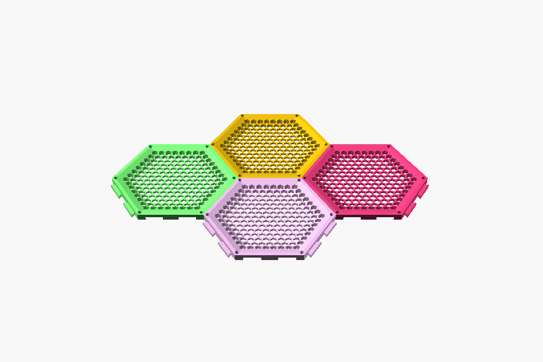

# stackable-drying-rack

A modular drying rack in OpenSCAD. Each unit is a hexagonal basin with a drainage grid of hexagonal holes.
Basins dovetail together edge to edge into a tray of any size, and rods through the six corner bores stack trays
into levels, with air between them.



## Make one

`rack.scad` renders one basin by default. Its parameters, at the top of the file:

- **`basin_diameter`** (150 mm), **`basin_height`** (8 mm), **`basin_thickness`** (2.4 mm): the basin. The diameter
  is across the hexagon's corners, measured to the middle of the wall.
- **`basin_grid_diameter`** (5 mm), **`basin_grid_spacing`** (1 mm): the drainage holes and the webs between them.
- **`rod_bore_diameter`** (5 mm): the corner bores, countersunk from both faces so a rod friction-fits.
- **`layout_basins`**, **`rows`**, **`cols`**: lay out a `rows` x `cols` tray to preview it. The console reports
  the tray's footprint.
- **`show_row_rods`**: draw the rods, to check the stacking.

Every basin has dovetail tabs on three alternate edges, two per edge at the default size, and matching slots on the
other three, 0.2 mm larger than the tabs each way, so any two basins join.

It needs the [tessella](https://github.com/CameronBrooks11/tessella) library at `v0.1.0`, which `scadman.lock`
pins. With [scadman](https://github.com/CameronBrooks11/scadman) installed:

```sh
scadman run rack.scad -o rack.stl   # or: scadman sync, then add the folder `scadman env` prints to OPENSCADPATH
```

Without scadman, clone tessella at that tag into your OpenSCAD libraries folder:

```sh
git clone --branch v0.1.0 https://github.com/CameronBrooks11/tessella.git
```

`just test` renders the basin and 1x2, 2x1 and 2x2 trays, and checks that neighbouring basins meet with their tabs
in each other's slots and no overlap.

## Printing

The first basin was printed on a Prusa XL with a 0.4 mm nozzle, PrusaSlicer 2.9.1:

- profile: 0.20mm SPEED @XLIS 0.4
- filament: Generic PETG, 240 °C, bed 80 °C
- 0.2 mm layers, 3 perimeters, 3 bottom and 5 top solid layers
- 10 % gyroid infill, supports on

The print files were removed from the repository; render `rack.scad` and slice it with these settings.

## Licence

[MIT](LICENSE).
